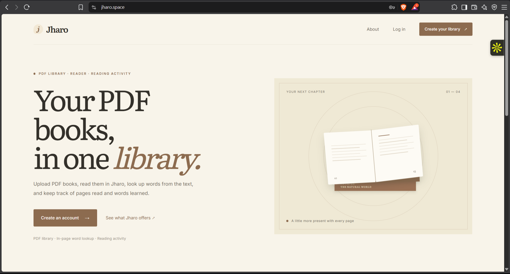
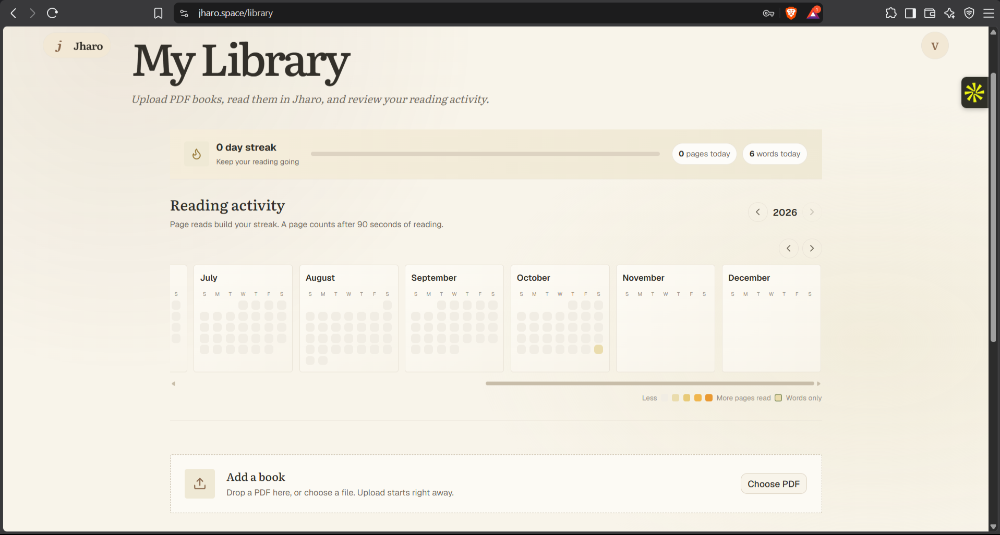
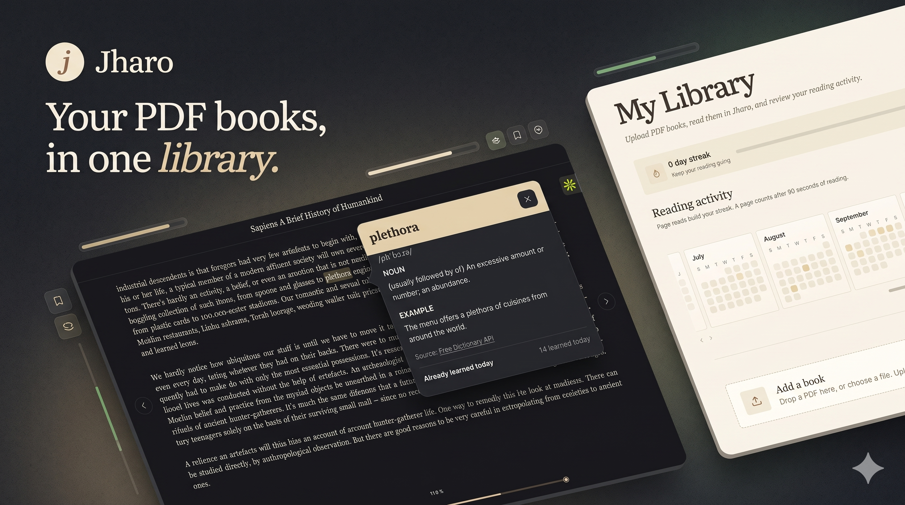

# Jharo

Jharo is a web app for reading PDF books. Users can upload PDFs to a personal library, read them in the browser, look up words from the text, and review pages read and words learned.

Live: [jharo.space](https://jharo.space)

## Screenshots

<!-- Add screenshots here, for example:


-->



## Features

- Email-verified accounts with JWT-based authentication.
- PDF upload to S3 using short-lived presigned URLs.
- Background PDF processing into reader pages, with Celery and PyMuPDF.
- Word definitions available from the reader.
- Daily reading activity for pages read and words learned.

## Architecture

```text
Browser -- HTTPS --> Nginx reverse proxy
                       +-- Next.js frontend
                       +-- Django REST API
                             +-- PostgreSQL (users, books, pages, activity)
                             +-- Redis + Celery (background PDF processing)
                             +-- Amazon S3 (PDFs and generated book assets)
```

In production, the Docker Compose services run on an AWS EC2 instance. PostgreSQL and Redis are Compose-managed containers; book files and generated assets are stored in S3.

## Tech stack

- **Frontend:** Next.js 15, React, TypeScript, SCSS
- **Backend:** Django 6, Django REST Framework, Simple JWT
- **Processing and storage:** Celery, Redis, PyMuPDF, Amazon S3
- **Database and deployment:** PostgreSQL, Docker Compose, AWS EC2, Nginx

## Run the containers

Docker Compose expects `frontend/.env` and `backend/.env` with the application and database configuration. In production, Nginx routes browser traffic to the frontend and API. Configure the same routing when accessing the stack locally.

```bash
docker compose up --build
```
